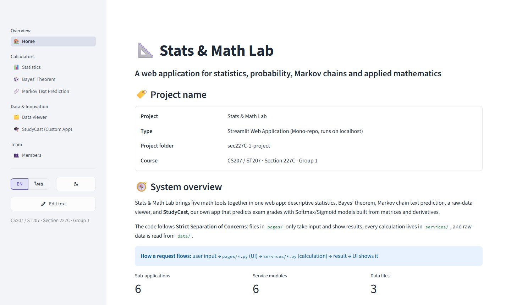
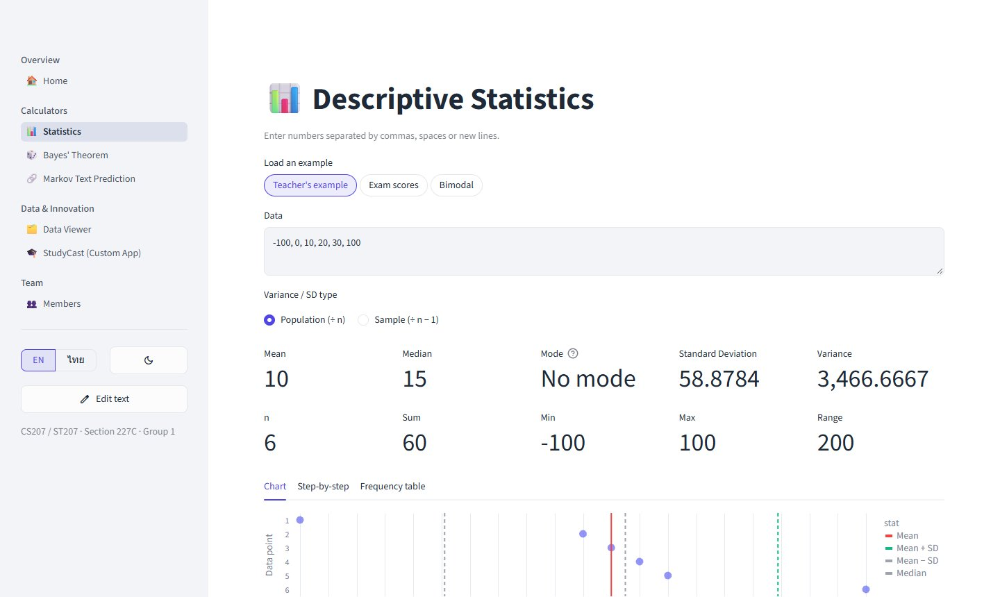
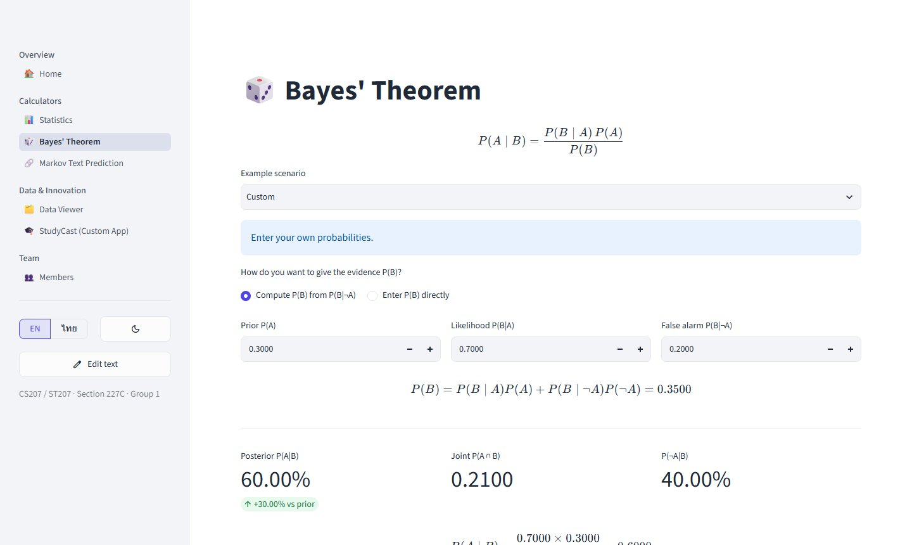
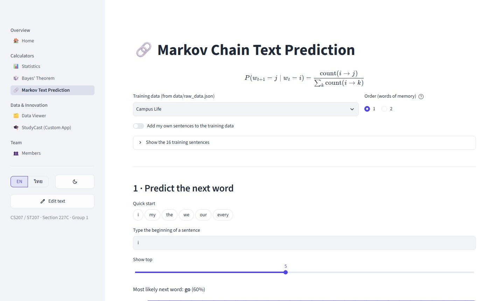
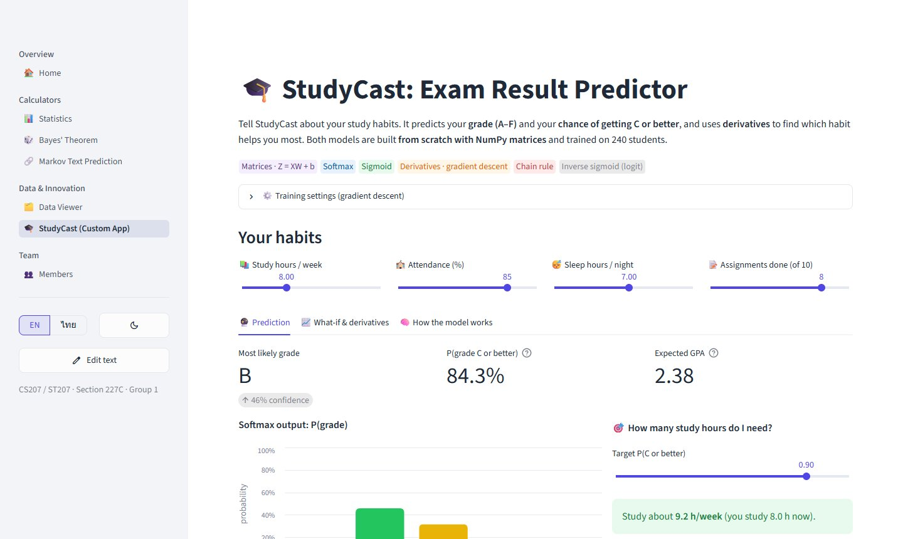

# 📐 Stats & Math Lab

A bilingual (Thai / English) **Streamlit** web app that puts five math tools in one place:
descriptive statistics, Bayes' theorem, Markov-chain text prediction, a data viewer, and
**StudyCast**, an exam-grade predictor built from scratch with NumPy matrices, softmax/sigmoid and
gradient descent.

> เว็บแอปคณิตศาสตร์และสถิติด้วย Streamlit (ภาษาไทย / อังกฤษ): สถิติเชิงพรรณนา, ทฤษฎีบทเบย์ส,
> ทำนายคำถัดไปด้วย Markov Chain และ StudyCast ทำนายเกรดจากพฤติกรรมการเรียน
> พัฒนาเป็นงานกลุ่มรายวิชา CS207 / ST207 มหาวิทยาลัยกรุงเทพ



## Features

| Page | What it does |
|---|---|
| 📊 **Descriptive Statistics** | Mean, median, mode, variance and SD (population or sample) with a step-by-step working, frequency table and chart |
| 🎲 **Bayes' Theorem** | Posterior P(A\|B) from prior, likelihood and false-alarm rate (total probability), with ready-made scenarios and the worked formula |
| 🔗 **Markov Text Prediction** | Builds a transition matrix from a text corpus (1st or 2nd order), predicts the next word and generates sentences; you can add your own training sentences |
| 🗂️ **Data Viewer** | Browses every file in `data/` with summaries |
| 🎓 **StudyCast** | Predicts a grade (A–F) and the chance of a C or better from study hours, attendance, sleep and assignments. Softmax + sigmoid models trained with gradient descent on 240 synthetic students, plus derivatives for "what-if" analysis (e.g. how many study hours you need) |
| 👥 **Members** | The team and who built what |

Also:

- **EN / ไทย** language switch on every page (Thai by default)
- **Dark / light** theme toggle
- **Edit text** from the browser (localhost only), saved to `data/custom_text.json`

| Statistics | Bayes' theorem |
|---|---|
|  |  |
| **Markov text prediction** | **StudyCast** |
|  |  |

## Run it locally

```bash
python -m venv venv
venv\Scripts\activate            # macOS / Linux: source venv/bin/activate
pip install -r requirements.txt
streamlit run main.py
```

Then open http://localhost:8501. Requires Python 3.10+.

## Project structure

The code follows a strict **separation of concerns**: files in `pages/` only take input and show
results, every calculation lives in `services/`, and data is read from `data/`.

```
├── main.py                 # routing (st.navigation), language, theme, text editor
├── pages/                  # UI only: input widgets + rendering
│   ├── home.py  statistics.py  bayes.py  markov.py
│   └── display_data.py  custom_app.py  members.py
├── services/               # all calculations
│   ├── cal_statistics.py   # mean, median, variance, SD
│   ├── cal_mode.py         # mode, frequency table
│   ├── cal_bayes.py        # posterior, total probability
│   ├── text_prediction.py  # Markov transition matrix, prediction, generation
│   ├── custom_service.py   # StudyCast: softmax / sigmoid, gradient descent, derivatives
│   ├── data_loader.py      # read, summarise and save data/
│   ├── i18n.py             # Thai / English text
│   ├── ui_helpers.py       # small UI helpers (editor access, chart sizes)
│   └── photo_store.py      # optional: save uploaded member photos to GitHub
├── data/
│   ├── students.json       # 240-student synthetic dataset for StudyCast
│   ├── raw_data.json       # text corpora for the Markov chain
│   ├── members.json        # team info
│   └── imgs/               # member pictures
└── .streamlit/config.toml  # light and dark themes
```

| Page | Service |
|---|---|
| statistics.py | cal_statistics.py, cal_mode.py |
| bayes.py | cal_bayes.py |
| markov.py | text_prediction.py |
| display_data.py | data_loader.py |
| custom_app.py | custom_service.py |
| members.py | data_loader.py |

## Built with

Python · Streamlit · NumPy · pandas · Altair

## Team

CS207 / ST207 group project, Section 227C, Group 1, Bangkok University (2026)

| Member | Role |
|---|---|
| Natchanon Aksornchai | Statistics developer |
| Wasuphon Phadphon | Probability (Bayes) developer |
| Sattawat Ueungprasert | Project lead, StudyCast developer |
| Phanparkarn Laochanaphinyo | Markov chain developer |
| Kanokwan Nopparit | UI/UX and data developer |
